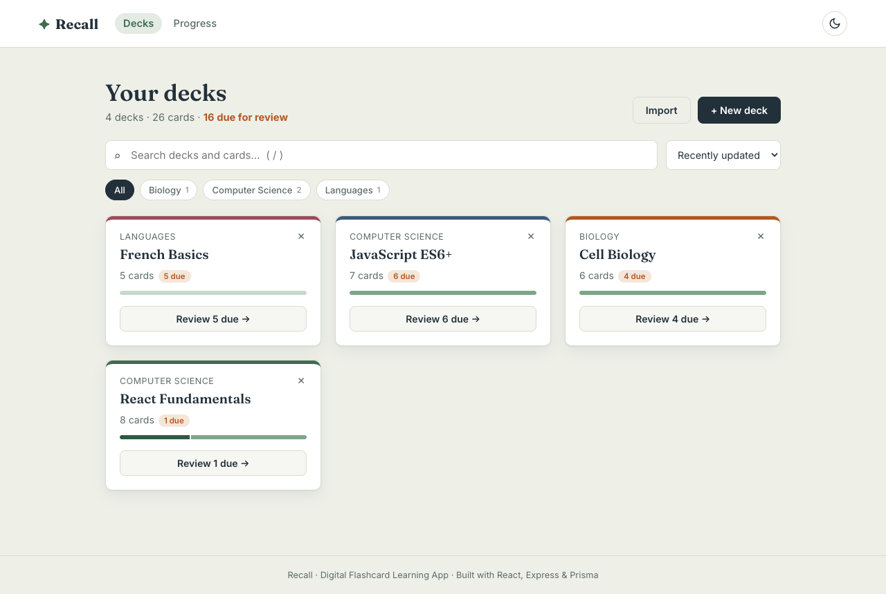
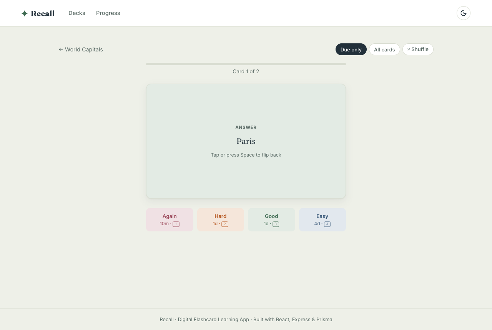
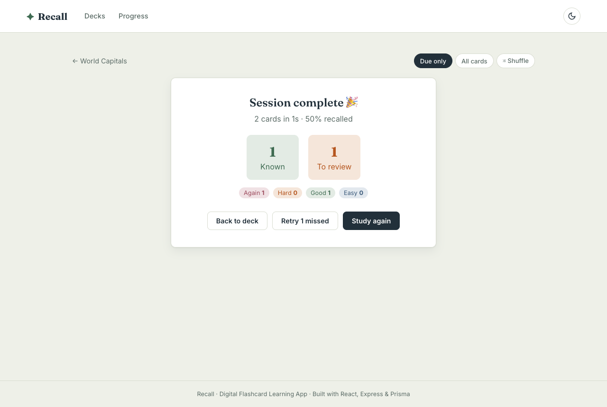
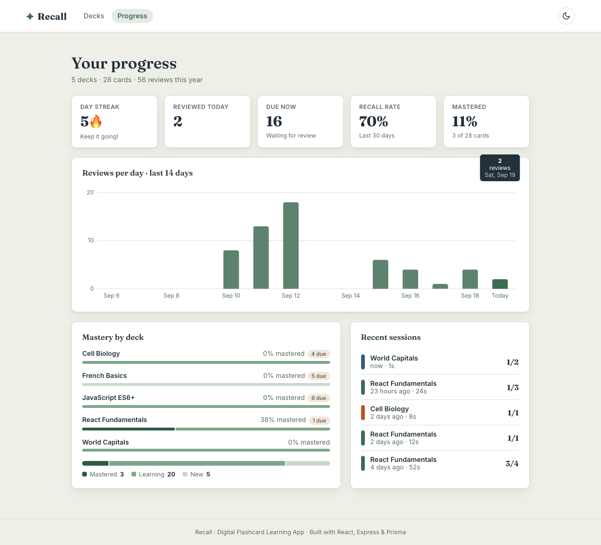
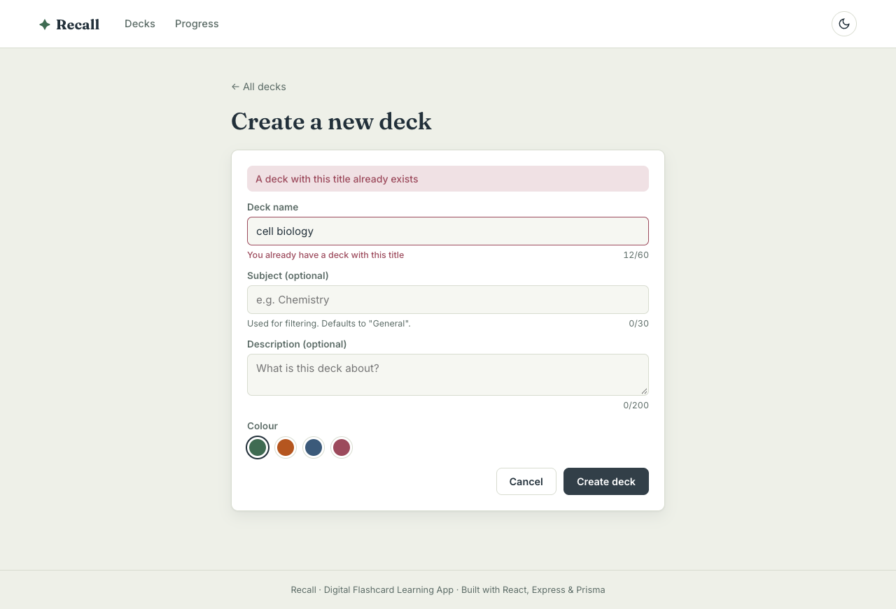
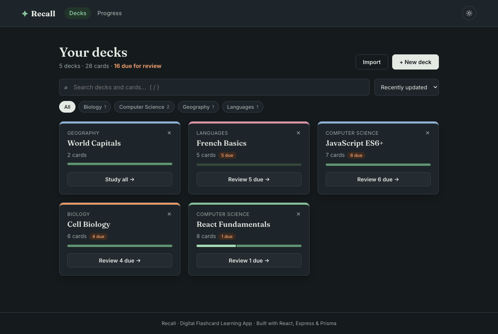
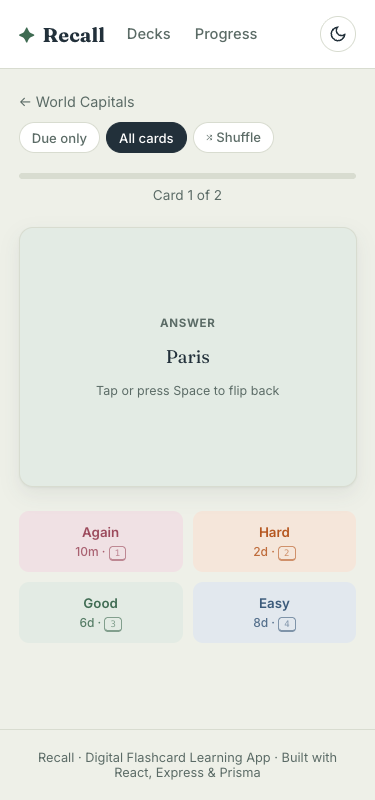

# ✦ Recall: Digital Flashcard Learning App

A full-stack flashcard app that schedules your reviews with **spaced repetition (SM-2)**, the algorithm behind Anki and SuperMemo. It shows each card just before you'd forget it.

- **Frontend:** React 18 · React Router 6 · Vite
- **Backend:** Node.js · Express 5 · Prisma ORM · SQLite
- **Testing:** Vitest · React Testing Library · Supertest · Playwright (E2E)

> Advanced Web Technologies mini project (SYMCA, Sem III, 2026–27)
> Ishita Khandelwal · PRN 125M1H044
> Phase I (FA-1) built the React UI with local state. Phase II (FA-2) adds everything below.



---

## Features

| FA-2 requirement | How Recall implements it |
|---|---|
| **React Hooks** | `useState`, `useEffect`, `useReducer` (study session state machine), `useContext` (toasts, confirm dialog), `useMemo`, `useCallback`, `useRef`, `useId`. There are also **7 custom hooks**: `useApi`, `useForm`, `useDebounce`, `useKeyboard`, `useLocalStorage`, `useTheme`, `useDocumentTitle` |
| **Routing** | React Router with a shared layout (`<Outlet />`), dynamic params (`/decks/:deckId`), query params (`?mode=due&shuffle=1`), programmatic navigation, active `NavLink`s, a 404 route |
| **Forms & validation** | Reusable `useForm` hook. Client-side rules mirror the server's **zod** schemas. Inline errors appear after blur, with live character counters. Server errors (such as a duplicate title → 409) show next to the right field |
| **API integration** | A `fetch` wrapper with timeouts, request cancellation (`AbortController`), and one `ApiError` type. Vite proxies `/api` in development; `VITE_API_URL` is used in production |
| **CRUD** | Full create, read, update and delete for **decks** and **cards**, plus import/export of decks as JSON, progress reset, and study sessions |
| **Search & filter** | Debounced, server-side deck search (matches card contents too), a subject filter, 4 sort orders, all synced to the URL. Client-side card search plus status filters (New / Learning / Mastered / Due) |
| **Error handling** | `ErrorBoundary`, a "server unreachable" banner, error states with retry, toasts, 404 pages, and a central Express error middleware that returns consistent JSON |
| **Responsive design** | Mobile-first CSS grid and flex layouts. Tested at 375 px with no horizontal scroll |
| **Performance** | Route-level code-splitting (`React.lazy` + `Suspense`), `React.memo` on list items, `useMemo`/`useCallback`, debounced search, cancelled stale requests, and a separate vendor chunk |
| **Testing** | **76 automated tests** (45 frontend, 31 backend) plus a 17-step browser E2E walkthrough |
| **Deployment** | Configs for Vercel/Netlify (frontend), a Render blueprint (backend), and a GitHub Actions CI workflow |

**Extras:** SM-2 spaced repetition with interval previews on each grade button · a progress dashboard (streak, recall rate, 14-day activity chart, mastery per deck) · keyboard shortcuts · dark mode · an accessible confirm dialog and flashcard · retry only the cards you missed.

---

## Quick start

Requires **Node.js 18+**.

```bash
npm run setup     # installs frontend + backend, creates the SQLite DB, seeds sample decks
npm run dev       # starts the API on :4000 and the web app on :5173
```

Open **http://localhost:5173**.

<details>
<summary>Run the two servers separately</summary>

```bash
# terminal 1
cd backend && npm run dev
# terminal 2
cd frontend && npm run dev
```
</details>

### Scripts

| Where | Command | What it does |
|---|---|---|
| root | `npm run setup` | Install everything, create and seed the DB |
| root | `npm run dev` | API and web app together |
| root | `npm test` | Frontend and backend tests |
| root | `npm run test:e2e` | Browser walkthrough (needs Chrome and both servers running) |
| root | `npm run build` | Production build into `frontend/dist/` |
| frontend | `npm run dev` | Web app only (Vite on :5173) |
| frontend | `npm test` | Frontend unit and component tests |
| backend | `npm run dev` | API only (Express on :4000) |
| backend | `npm test` | Backend API and SM-2 tests |
| backend | `npm run db:seed` | Re-seed sample decks and history |
| backend | `npm run db:reset` | Wipe the DB and re-seed |
| backend | `npm run db:studio` | Browse the database in Prisma Studio |

### Keyboard shortcuts

| Key | Where | Action |
|---|---|---|
| `/` | Decks | Focus search |
| `Space` / `Enter` | Study | Flip card |
| `1` `2` `3` `4` | Study | Grade: Again / Hard / Good / Easy |
| `Esc` | Study | Back to deck |
| `Ctrl/⌘ + Enter` | Card form | Save card |

---

## Architecture

```
┌──────────────────────────── Browser ────────────────────────────┐
│  React SPA (Vite)                                               │
│  pages/ ── components/ ── hooks/ (useApi, useForm, …)           │
│              │                                                  │
│          api/client.js  (fetch + timeout + ApiError)            │
└──────────────┬──────────────────────────────────────────────────┘
               │  JSON over HTTP   /api/*
┌──────────────▼──────────────────────────────────────────────────┐
│  Express 5 API                                                  │
│  routes/ → validate(zod) → handlers → errorHandler              │
│              │                   └── lib/srs.js (SM-2)          │
│          Prisma Client                                          │
└──────────────┬──────────────────────────────────────────────────┘
               ▼
         SQLite (dev.db)   Deck 1─* Card 1─* Review ; Deck 1─* StudySession
```

### Folder structure

```
recall-flashcard-app-source/
├── package.json              # root scripts only: setup, dev (runs both), test, build
├── frontend/                 # React SPA (Vite)
│   ├── src/
│   │   ├── api/              # fetch wrapper + endpoint functions
│   │   ├── components/       # DeckCard, CardRow, Flashcard, forms, charts, ErrorBoundary…
│   │   ├── context/          # ToastContext, ConfirmContext
│   │   ├── hooks/            # 7 custom hooks
│   │   ├── layouts/          # AppLayout: navbar + <Outlet/> + error boundary + Suspense
│   │   ├── pages/            # Dashboard, DeckDetail, DeckForm, Study, Stats, NotFound
│   │   ├── utils/            # validators, SM-2 preview, formatting
│   │   └── test/             # Vitest + RTL tests
│   ├── public/               # static files (incl. Netlify _redirects)
│   ├── e2e/walkthrough.mjs   # Playwright end-to-end run
│   ├── index.html · vite.config.js · vercel.json · .env.example
│   └── package.json
├── backend/
│   ├── prisma/               # schema.prisma, seed.js
│   ├── src/
│   │   ├── routes/           # decks, cards, sessions, stats
│   │   ├── middleware/       # validate (zod), errorHandler
│   │   ├── validators/       # zod schemas
│   │   └── lib/              # prisma client, SM-2, serializers
│   └── tests/                # Supertest API tests + SM-2 unit tests
├── docs/                     # report, slides, screenshots
├── render.yaml · .github/workflows/ci.yml
```

### Data model

| Model | Key fields |
|---|---|
| **Deck** | `id`, `title`, `subject`, `description`, `swatch`, timestamps |
| **Card** | `front`, `back`, `deckId`, plus SM-2 state: `easeFactor`, `interval`, `repetitions`, `lapses`, `reviewCount`, `dueAt`, `lastReviewedAt` |
| **Review** | `cardId`, `grade` (0–3), `reviewedAt` (one row per answer, used for stats) |
| **StudySession** | `deckId`, `mode`, `total`, `known`, `review`, `durationSec` |

Deleting a deck cascades to its cards, reviews and sessions.

### How scheduling works (SM-2)

After you flip a card, you grade yourself **Again / Hard / Good / Easy**:

- **Again** resets the streak, and the card comes back in 10 minutes. The ease factor drops.
- **Good** follows the intervals 1 day → 6 days → previous interval × ease factor (starts at 2.5).
- **Hard** gives a shorter interval (×0.8). **Easy** gives a longer one (×1.3).
- A card counts as **mastered** once its interval reaches 7 days.

The algorithm is a pure function in [backend/src/lib/srs.js](backend/src/lib/srs.js) and is unit-tested.

---

## REST API

Base URL: `/api`. Errors always come back as `{ "error": { "status", "message", "fields?" } }`.

| Method | Endpoint | Description |
|---|---|---|
| GET | `/health` | Health check (also pings the DB) |
| GET | `/decks?q=&subject=&sort=recent\|title\|cards\|due` | List, search, filter and sort decks, with counts |
| GET | `/decks/subjects` | Distinct subjects with deck counts |
| POST | `/decks` | Create a deck → `201` (`400` if invalid, `409` if the title exists) |
| GET | `/decks/:id` | A deck with all its cards |
| PUT/PATCH | `/decks/:id` | Update a deck |
| DELETE | `/decks/:id` | Delete a deck and its cards → `204` |
| POST | `/decks/:id/reset` | Reset spaced-repetition progress |
| GET | `/decks/:id/export` | Download the deck as JSON |
| POST | `/decks/import` | Create a deck from JSON (duplicate questions removed) |
| GET | `/decks/:id/cards?q=&status=` | Search and filter cards |
| POST | `/decks/:id/cards` | Add a card (`409` on a duplicate question) |
| GET | `/decks/:id/study?mode=all\|due&shuffle=1` | Cards for a study session |
| GET | `/cards/:id` | One card |
| PUT/PATCH | `/cards/:id` | Edit a card |
| DELETE | `/cards/:id` | Delete a card |
| POST | `/cards/:id/review` | `{ grade: 0–3 }` → reschedules with SM-2 |
| GET/POST | `/sessions` | Recent study sessions / save a session |
| GET | `/stats?tzOffset=` | Totals, streak, recall rate, 14-day activity, per-deck mastery |

---

## Testing

```bash
npm test           # 76 unit/integration tests (frontend + backend)
npm run test:e2e   # real-browser walkthrough (servers must be running)
```

- **Backend (31):** SM-2 maths, streak calculation, and every endpoint through Supertest, including validation (400), conflicts (409), not found (404), malformed JSON, cascade deletes, search, sorting, import/export and stats. The tests run against a throwaway `test.db` and refuse to run against any other database.
- **Frontend (45):** validators, the API client (timeouts, network errors, field errors), custom hooks (debounce with fake timers, form state, request cancellation), components (forms, flashcard, deck card, error boundary), and page-level tests with a mocked API (debounced search, subject filter, delete confirmation, a full keyboard-driven study session).
- **E2E (17 steps):** creates a deck, hits both validation paths, adds, edits, searches and deletes cards, studies with the keyboard, checks stats, dark mode, 404s, mobile layout and JSON import, then cleans up after itself.

---

## Deployment

**Frontend (Vercel or Netlify).** Import the repo and set the project's root directory to `frontend`. Set `VITE_API_URL` to your backend URL (for example `https://recall-api.onrender.com`). The SPA fallback is already configured in `frontend/vercel.json` and `frontend/public/_redirects`.

**Backend (Render).** `render.yaml` is a ready blueprint (`rootDir: backend`). Set `CORS_ORIGIN` to your frontend URL. On free hosting the SQLite file is ephemeral. For persistent data, change `provider = "postgresql"` in `schema.prisma` and point `DATABASE_URL` at a Postgres database. No code changes are needed.

**CI.** `.github/workflows/ci.yml` runs both test suites and a production build on every push.

---

## Screenshots

| Study (answer side) | Session summary | Progress |
|---|---|---|
|  |  |  |

| Validation | Dark mode | Mobile |
|---|---|---|
|  |  |  |
